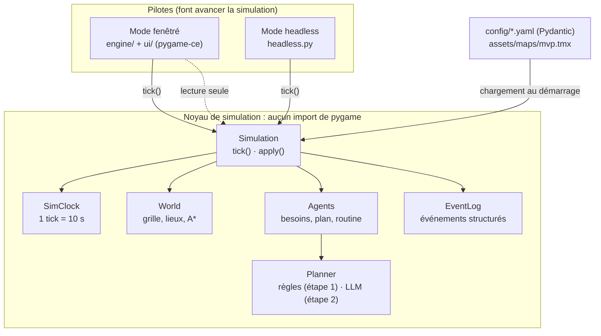
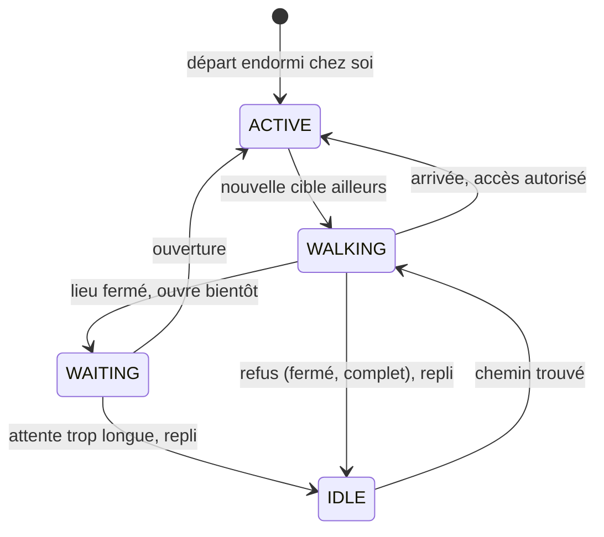

# Architecture de PixelCity

Ce document explique les choix structurants du projet et **pourquoi** ils ont été faits. Il est mis à jour à chaque étape.

## Vue d'ensemble

**Convention** : identifiants du code en anglais (standard de l'industrie), commentaires et textes affichés en français.

## 1. Simulation et rendu strictement séparés

Le noyau (`sim/`, `world/`, `agents/`, `config/`) n'importe jamais pygame. Le rendu lit l'état de la simulation et ne le modifie pas. Toute action extérieure passe par `Simulation.apply(commande)` et s'exécute au début du tick suivant (patron Commande) : chaque changement a lieu à un instant précis, donc reproductible.

**Pourquoi** : tester vite, simuler des semaines en quelques secondes, et à l'étape 6 lancer des dizaines de simulations A/B en parallèle, sans fenêtre.

**Comment c'est garanti** : `tests/test_simulation.py::test_le_noyau_tourne_sans_pygame` lance un interpréteur neuf, simule une journée et échoue si `pygame` apparaît dans `sys.modules`. Ce test a immédiatement révélé un problème réel (voir « Pièges rencontrés »).

Dans `main.py`, le moteur n'est importé que si l'on ouvre une fenêtre (import « paresseux »).

## 2. Un temps simulé discret

| Grandeur | Valeur |
|---|---|
| Durée d'un tick | 10 secondes simulées (comme Smallville) |
| Ticks par jour | 8 640 |
| Vitesse x1 | 14,4 ticks par seconde réelle (1 jour ≈ 10 min) |
| Vitesse x10 | 144 ticks par seconde réelle |
| Headless | aussi vite que possible (≈ 50 000 ticks/s avec 3 habitants) |

La vitesse ne change **jamais** la taille du tick, seulement le nombre de ticks exécutés par seconde réelle (`engine/app.py`, patron de l'accumulateur, « Fix Your Timestep! » de Glenn Fiedler, 2004). À x10, un habitant fait exactement la même chose qu'à x1. Le rendu interpole les positions entre deux ticks pour rester fluide, et un plafond de ticks par image évite la « spirale de la mort » quand la machine ne suit plus.

L'horloge (`sim/clock.py`) ne lit jamais l'heure réelle. Le tick 0 est un lundi à 00:00.

## 3. Déterminisme

Même graine ⇒ même simulation, à l'octet près. Règles appliquées partout dans le noyau :

- un générateur `random.Random` **par sous-système**, dérivé de la graine maîtresse par SHA-256 (`sim/rng.py`) : ajouter un tirage dans un sous-système ne décale pas les autres ;
- jamais `hash()` pour dériver une graine (randomisé à chaque lancement de Python) ;
- jamais d'itération sur un `set` de chaînes (ordre variable d'un lancement à l'autre) : des `dict` (ordonnés) ou des listes ;
- jamais l'heure réelle dans la simulation ;
- ordre de mise à jour des agents fixe (celui de `agents.yaml`).

Le journal des événements calcule une empreinte SHA-256 cumulative : deux simulations identiques ont la même empreinte (testé).

**Limite connue pour la suite** : un LLM n'est pas parfaitement déterministe, même à température 0. À l'étape 2, on ajoutera un mode où l'horloge attend les réponses (« lockstep ») et un cache des réponses. Pour les tests A/B de l'étape 6, on comparera des **distributions** sur plusieurs simulations par variante, pas un duel unique.

## 4. La carte : Tiled pour la géographie, YAML pour les règles

- `assets/maps/mvp.tmx` : où sont les choses (sol, murs, portes, rectangles des lieux).
- `config/city.yaml` : ce que font les lieux (horaires, capacité, activités proposées, effets).
- Le lien : la propriété `place_id` de chaque rectangle Tiled = l'`id` du lieu dans le YAML. Les deux sources sont contrôlées croisées au chargement.

La grille de marche vient des propriétés des tuiles : coût 1 (trottoir, passage piéton, allée, porte), 3 (pelouse), 8 (chaussée), 0 (infranchissable). A* minimise la somme des coûts : les habitants empruntent naturellement trottoirs et passages piétons, sans règle spéciale. Les entrées d'un lieu sont détectées automatiquement (cases marchables du bord, ouvertes vers l'extérieur) et la connexité de toutes les entrées est vérifiée au chargement.

**Lieux, pas seulement bâtiments** : le parc est un lieu extérieur, sans murs ; l'agent y reste visible et y flâne. À l'étape 4, le marché et le stade fonctionneront pareil.

**Smart objects** : chaque lieu « annonce » ses activités et leurs effets sur les besoins (principe des *Sims*, 2000). L'agent cherche un lieu qui annonce `eat` ; il n'a jamais « si faim alors boulangerie » codé en dur. Les activités réservées aux employés (`staff_activities`) sont accessibles hors des heures d'ouverture : le boulanger arrive avant ses clients.

## 5. Les habitants

### Besoins

Jauges de 0 à 100 (faim, énergie, hygiène, loisir) qui baissent avec le temps simulé et remontent avec les activités. Un besoin devient urgent sous son seuil `critical` et n'est considéré comblé qu'au-dessus de `satisfied` : cette **hystérésis** évite qu'un agent mange une bouchée, reparte et revienne aussitôt. Le loisir n'est jamais une urgence (on ne quitte pas son travail parce qu'on s'ennuie) et l'hygiène ne réveille personne.

Le social arrivera à l'étape 2 (il faut des conversations). L'argent et la santé ne sont pas des besoins comme les autres (une ressource, un état lent) : ils seront modélisés comme tels à l'étape 4.

### Plans

Un `DayPlan` est une suite de blocs « lieu + activité » couvrant exactement 24 heures, en **minutes absolues** depuis le début de la simulation (pas de piège de minuit). Le `PlanBuilder` construit des plans sans trou par construction : chaque bloc commence là où le précédent s'arrête.

Les blocs de travail sont **ponctuels** : la routine fait partir l'agent assez tôt (temps de trajet estimé + 5 min) pour arriver à l'heure. Les autres blocs commencent à l'arrivée.

### Planificateur interchangeable

`Planner` est un `Protocol` (typage structurel) : la routine appelle `plan_day()` sans savoir qui répond. Aujourd'hui, `RuleBasedPlanner` combine métier, jour de la semaine et pondérations de personnalité (Big Five) pour choisir lieux et durées. À l'étape 2, un `LLMPlanner` répondra à la même interface et gardera le planificateur à règles comme repli.

### Routine : une machine à états explicite

À chaque tick : plan du jour → besoins → urgences → choix de la cible (dérogation, sinon bloc du plan, avec départ anticipé) → machine à états. Les **dérogations** (`Override`) gèrent les urgences (faim critique : aller manger au lieu ouvert le plus proche) et les replis (lieu fermé : un autre lieu équivalent, sinon la maison), sans jamais réécrire le plan.

Les chemins sont des **tuples immuables** partagés via le cache du pathfinder : l'agent avance avec un index au lieu de modifier le chemin, sinon il corromprait le cache pour tous les autres.

## 6. Événements

Chaque action notable produit un `Event` structuré (tick, type, agent, lieu, données JSON). Le journal est observable (patron Observateur) : aujourd'hui le mode headless s'y abonne ; plus tard, le journal de l'interface (étape 5), la persistance SQLite (étape 7) et les métriques du Test de produit (étape 6).

## 7. Configuration

Les YAML sont validés par Pydantic au démarrage (on valide aux frontières, on fait confiance à l'intérieur) avec `extra="forbid"` (une faute de frappe dans une clé est une erreur, pas un silence) et `frozen=True`. Les erreurs nomment l'élément fautif par son `id` (`agents.lea.home`) plutôt que par son indice. Lecture avec `yaml.safe_load` uniquement.

## Pièges rencontrés pendant l'étape 1

| Piège | Ce qui s'est passé | Parade |
|---|---|---|
| `import pytmx` importe pygame | Son `__init__.py` charge ses outils pygame dès qu'il le peut. Le test de frontière l'a détecté. | Lecteur TMX minimal maison pour le noyau (`world/tmx.py`) ; pytmx seulement dans le rendu. |
| Une `StrEnum` hérite de `str` | Une propriété `Weekday.index` écrasait `str.index()` en silence. `mypy --strict` l'a signalé. | Propriété renommée `number`. |
| YAML 1.1 et les heures | Sans guillemets, `23:00` devient le nombre 1380 (base 60), mais `07:00` reste une chaîne. | Les heures sont exigées entre guillemets, avec un message d'erreur explicite. |
| Équilibrage des besoins | Les premières valeurs faisaient tomber l'hygiène à 15 chaque nuit et le loisir à 0 en fin de semaine. | Réglages ajustés en simulant 3 semaines sur plusieurs graines (écart min-max de chaque jauge). |

## Préparé pour la suite

- `Planner` (Protocol) : point de branchement du LLM à l'étape 2.
- `Simulation.apply()` : point d'entrée du mode Dieu (étape 5) et des réponses asynchrones du LLM (étape 2).
- `EventLog` : source des métriques, du journal et de la persistance.
- `resources.py` : résolution des chemins prête pour PyInstaller (étape 8).

## Limites connues

- Tous les agents sont mis à jour à chaque tick (≈ 7 µs par agent). Avec 100 habitants, une journée simulée prendrait environ 6 s en headless, contre 0,2 s aujourd'hui ; l'étape 7 passera à une mise à jour événementielle (un agent qui dort n'a rien à calculer).
- Les habitants se traversent (pas de collisions entre eux), comme dans Smallville : gérer les embouteillages coûterait beaucoup pour un gain visuel faible.
- Les intérieurs ne sont pas encore affichés (étape 5) : une pastille de couleur au-dessus de la porte indique qui est à l'intérieur.
- Sous Windows avec un écran haute densité, la fenêtre peut être mise à l'échelle par le système (image légèrement floue) ; à traiter lors de l'interface complète (étape 5).
