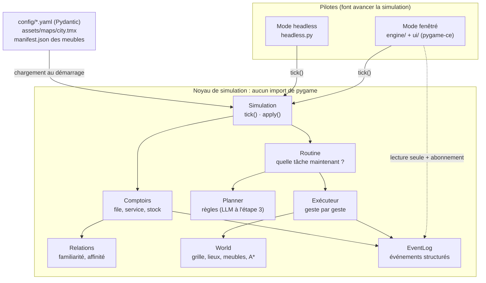
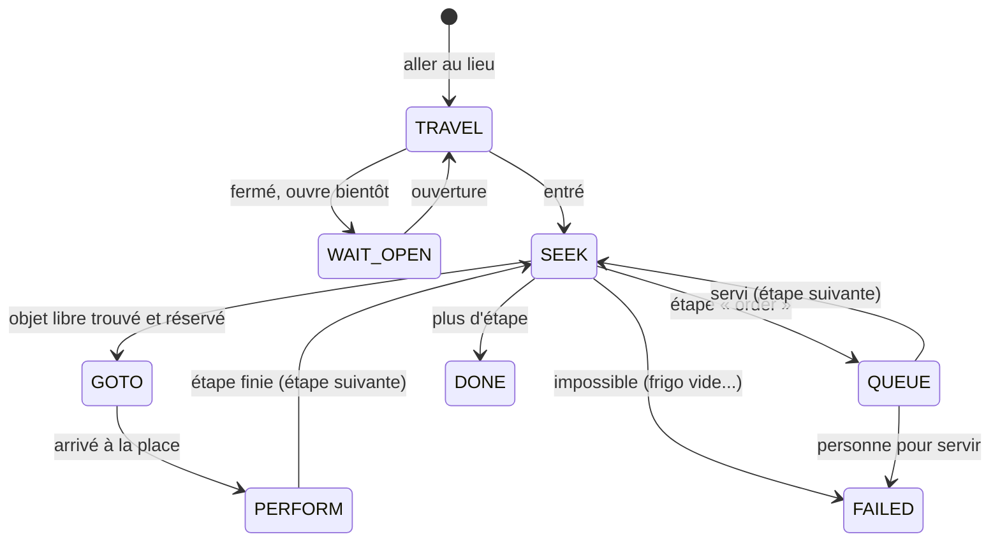
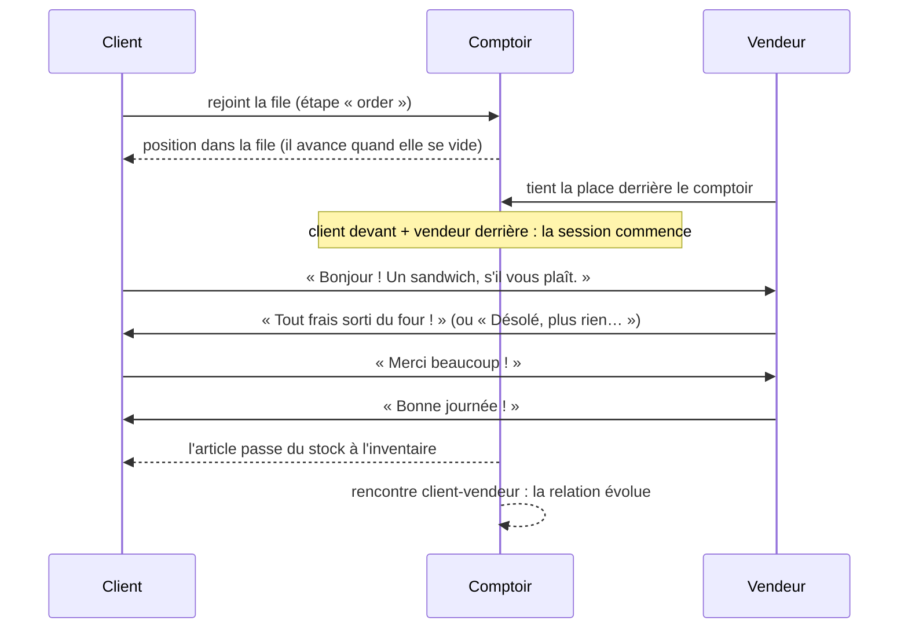

# Architecture de PixelCity

Ce document explique les choix structurants du projet et **pourquoi** ils ont été faits. Il est mis à jour à chaque étape (dernière mise à jour : étape 2, « ville visible »).

## Vue d'ensemble



**Convention** : identifiants du code en anglais (standard de l'industrie), commentaires et textes affichés en français.

## 1. Simulation et rendu strictement séparés

Le noyau (`sim/`, `world/`, `agents/`, `config/`) n'importe jamais pygame. Le rendu lit l'état de la simulation et ne le modifie pas. Toute action extérieure passe par `Simulation.apply(commande)` et s'exécute au début du tick suivant (patron Commande) : chaque changement a lieu à un instant précis, donc reproductible.

**Pourquoi** : tester vite, simuler des semaines en quelques secondes, et plus tard lancer des dizaines de simulations A/B en parallèle, sans fenêtre.

**Comment c'est garanti** : `tests/test_simulation.py::test_le_noyau_tourne_sans_pygame` lance un interpréteur neuf, simule une journée et échoue si `pygame` apparaît dans `sys.modules`. Même le catalogue des meubles (`world/catalog.py`) ne lit que du JSON : les images ne sont chargées que par le moteur.

## 2. Un temps simulé discret

| Grandeur | Valeur |
|---|---|
| Durée d'un tick | 10 secondes simulées (comme Smallville) |
| Ticks par jour | 8 640 |
| Vitesse x1 | 6 ticks par seconde réelle : 1 minute simulée = 1 seconde (1 jour = 24 min) |
| Vitesses x3, x10, x30 | 18, 60, 180 ticks par seconde réelle |
| Headless | aussi vite que possible (≈ 22 000 ticks/s avec 6 habitants : une semaine en 3 s) |

La vitesse ne change **jamais** la taille du tick, seulement le nombre de ticks exécutés par seconde réelle (`engine/app.py`, patron de l'accumulateur, « Fix Your Timestep! » de Glenn Fiedler, 2004). À x30, un habitant fait exactement la même chose qu'à x1. Le rendu interpole les positions entre deux ticks, et un plafond de ticks par image évite la « spirale de la mort » quand la machine ne suit plus.

L'étape 2 a ralenti x1 (1 jour = 24 min au lieu de 10) : à l'ancienne vitesse, on ne voyait pas quelqu'un sortir le beurre du frigo, et les bulles disparaissaient avant d'être lues.

## 3. Déterminisme

Même graine ⇒ même simulation, à l'octet près. Règles appliquées partout dans le noyau :

- un générateur `random.Random` **par sous-système**, dérivé de la graine maîtresse par SHA-256 (`sim/rng.py`) : `planner:lea`, `stroll:paul`, `dialogue:<comptoir>`, `relations`... Ajouter un tirage dans un sous-système ne décale pas les autres ;
- jamais `hash()` pour dériver une graine (randomisé à chaque lancement de Python) ;
- jamais d'itération sur un `set` de chaînes : des `dict` (ordonnés) ou des listes ;
- jamais l'heure réelle dans la simulation (l'interface, elle, mesure ses animations en temps réel, mais ne touche pas au noyau) ;
- ordre de mise à jour fixe : les habitants dans l'ordre de `agents.yaml`, puis les comptoirs.

Le journal des événements calcule une empreinte SHA-256 cumulative : deux simulations identiques ont la même empreinte (testé).

**Limite connue pour la suite** : un LLM n'est pas parfaitement déterministe, même à température 0. À l'étape 3, on ajoutera un mode où l'horloge attend les réponses (« lockstep ») et un cache des réponses.

## 4. La carte : Tiled pour la géographie, YAML pour les règles

- `assets/maps/city.tmx` (généré par `tools/make_city.py`) : où sont les choses. Deux couches de tuiles (`ground`, `walls`) et trois calques d'objets (`places`, `rooms`, `furniture`).
- `config/city.yaml` : les règles des lieux (horaires, capacité, qui peut y faire quoi).
- `config/objects.yaml` : ce que permet chaque type de meuble.

La ville est construite par **gabarits** (maison, appartement, boulangerie...) posés sur un plan de rues : c'est ce qui permettra de passer à une centaine de bâtiments sans tout dessiner à la main.

La grille de marche vient des propriétés des tuiles : coût 1 (trottoir, passage piéton, allée, sol intérieur), 3 (pelouse), 8 (chaussée), 0 (mur, eau). Les meubles bloquent ensuite leurs tuiles « au sol ». A* minimise la somme des coûts : les habitants empruntent naturellement trottoirs et passages piétons.

Au chargement, on vérifie : pas deux meubles au même endroit, toutes les entrées reliées, chaque place d'utilisation atteignable depuis la porte de son lieu. Ces contrôles ont attrapé un vrai bug de gabarit (voir « Pièges »).

## 5. Les meubles : des « smart objects »

Le principe des *Sims* (2000) : l'intelligence est dans les objets, pas dans les personnages. Un habitant n'a jamais « si faim alors frigo » codé en dur ; sa recette demande le verbe `take_food`, et il cherche un objet qui le propose.

| Notion | Exemple | Où |
|---|---|---|
| Emprise et rangées d'arrière-plan | le lit fait 1×3 ; sa rangée du haut « dépasse » sur le mur | `manifest.json` (format pixel-agents) |
| Place d'utilisation (`Spot`) | devant le frigo, sur la chaise, derrière le comptoir | `objects.yaml`, `world/furniture.py` |
| Posture et orientation | assis face à la table, couché, caché (douche) | `objects.yaml` |
| Rôle | `staff` derrière le comptoir, `customer` devant, `resident` pour le lit | `objects.yaml` |
| Verbes accordés (`grants`) | la table donne `eat` aux chaises qui la regardent ; la télé donne `watch_tv` au canapé | `world/furniture.py::apply_grants` |
| Stock (`container`) | le frigo et ses provisions, la vitrine et ses sandwichs | `objects.yaml` |

Une place se **réserve** : deux habitants ne prennent jamais la même chaise (vérifié sur une semaine par les tests). Un siège est infranchissable, mais A* accepte de le prendre pour départ ou pour arrivée : on va s'asseoir sur une chaise, on ne la traverse pas.

Les verbes accordés savent qui les accorde (`Spot.granted_by`) : c'est la télé qu'on allume quand on regarde la télé depuis le canapé, pas le canapé.

## 6. Recettes et tâches : les besoins deviennent des gestes

Une **recette** (`actions.yaml`) est une suite d'étapes. Chaque étape a un verbe, une durée (ou « jusqu'à la fin du bloc »), des effets sur les besoins (en points par heure) et des mouvements d'objets : `take` (frigo → main), `consume` (main → mangé), `put` (main → frigo, avec conversion : un sac de courses = 10 provisions), `produce` (four → vitrine), `make` (provisions → gamelle), `buy` (comptoir → main, via le service).

Une **tâche** (`agents/tasks.py`) exécute une recette. Chaque étape traverse les mêmes phases :



Les tâches **s'empilent** (`Agent.tasks`) : en bas, la tâche du bloc du plan ; au-dessus, ce qui passe devant. Comme une pile d'appels : on traite l'interruption, puis on reprend.

- **Urgence** (`URGENT`) : un besoin critique (vessie, faim, fatigue, hygiène). L'étape interrompue garde le temps qui lui restait ; un objet allumé le reste (le four continue de cuire). On finit son assiette d'abord si elle est presque vide, et on passe aux toilettes *avant* de quitter un lieu qui en a.
- **Service** (`SERVE`) : un commerçant à son poste, un client qui attend, personne au comptoir : il y va.
- **Corvée** (`CHORE`) : rentrer chez soi avec des courses déclenche leur rangement.

Quand le bloc du plan change, une tâche **entamée** (on a commandé son plat, rempli son panier) peut déborder un peu plutôt que d'être abandonnée à mi-chemin. Une tâche finie en avance laisse place à un « bouche-trou » adapté au lieu (télé, flâner au parc), ou l'on passe directement au bloc suivant.

## 7. Les comptoirs : un petit protocole entre deux habitants



Comme une poignée de main réseau (SYN, SYN-ACK, ACK), rien ne se passe tant que les deux ne sont pas en place. Sans caissière, la caisse du supermarché (`self_service: true`) passe en libre-service au bout de deux minutes. Depuis l'étape 3, le comptoir lance une conversation (section 8 bis) et attend qu'elle se termine avant de remettre l'article.

## 8. Relations

Chaque service au comptoir est une rencontre (`sim/relations.py`) : la familiarité augmente, l'affinité bouge selon la compatibilité des caractères (Big Five : agréabilité et extraversion aident, ouvertures proches aussi, névrosisme complique). L'effet des premières rencontres est le plus fort. Paliers : froid, connaissance, sympathie, amitié, grande amitié. Choix assumé pour démarrer : une affinité symétrique par paire.

## 8 bis. Conversations par LLM local (étape 3)

Paquet `pixelcity/llm/` (sans pygame, sans la boucle) et `sim/conversation.py` (l'intégration).

```
comptoir / rencontre en ville
        │ photo figée (ConversationRequest : personas, lieu, heure, relation, souvenir, flirt autorisé ?)
        ▼
DialogueBackend ── ScriptedBackend : dialogues.yaml, instantané, reproductible (tests, repli)
                └─ OllamaBackend : 1 fil de travail → POST /api/chat avec un schéma JSON
        │ Pending (on vient vérifier à chaque tick : polling)
        ▼
réponse validée (prompts.parse_result) → bulles espacées selon leur longueur → effet sur la relation
```

- **Jamais d'appel réseau dans la boucle** : une génération prend plusieurs secondes, la fenêtre gèlerait. La requête part dans un `ThreadPoolExecutor` à un seul fil (le GPU ne génère qu'une chose à la fois) ; pendant l'attente, une bulle « … ». La réponse n'est appliquée au monde que pendant un tick.
- **Le LLM propose, la simulation dispose** : on lui dit si l'article est en stock ; sa sortie est contrainte par un schéma JSON (`format` d'Ollama), puis nettoyée comme une entrée utilisateur (orateurs connus seulement, répliques coupées à 110 caractères, affinité bornée à ±6, flirt ignoré s'il n'était pas autorisé).
- **Flirt** : uniquement entre deux adultes (18 ans ou plus), tous deux `romance: true`, sans autre partenaire, et qui s'apprécient déjà (affinité ≥ 20). La règle est dans le code (`flirt_allowed`), pas dans le prompt : un prompt se contourne, un `if` non.
- **Rencontres en ville** : à chaque minute simulée, deux habitants à deux cases l'un de l'autre, dans la rue, au parc, au café ou à la salle de sport, peuvent s'arrêter. La chance dépend de leur extraversion et de leur relation ; délais de 6 h par paire et 45 min par habitant ; jamais pendant une envie pressante ni en servant. Les deux s'arrêtent (`Agent.conversation`), se font face, puis reprennent leur tâche là où elle en était.
- **Souvenir** : le LLM résume chaque échange en une phrase (`Relation.summary`), redonnée au prochain prompt de la même paire. C'est l'embryon de la mémoire de l'étape 5.
- **Repli** : Ollama éteint, modèle absent, JSON invalide, ou plus de 20 minutes simulées d'attente (aux vitesses x10 et x30) → répliques scriptées. La pastille sous l'horloge dit qui écrit.
- **Réglages** : `.env` (voir `.env.example`), lu sans dépendance ; les variables d'environnement l'emportent. Un habitant peut avoir son modèle (`llm_model` dans `agents.yaml`).
- **Déterminisme** : garanti avec le script (les tests). Avec un LLM, la graine est transmise à Ollama mais la génération dépend du matériel et du temps de réponse : on l'accepte, c'est le prix du langage naturel.

## 9. Le planificateur

`Planner` est un `Protocol` (typage structurel) : la routine appelle `plan_day()` sans savoir qui répond. `RuleBasedPlanner` construit une journée de blocs « lieu + activité + recette » en minutes absolues, sans trou par construction (`PlanBuilder`). Il tient compte :

- du métier et des horaires (blocs de travail **ponctuels** : la routine fait partir l'habitant assez tôt) ;
- du trajet domicile-travail (on raccourcit le matin si besoin) ;
- du **frigo** : peu de provisions, des courses sont ajoutées à la journée ;
- du déjeuner : dehors si un lieu est ouvert assez longtemps, à la maison si elle est proche, sinon une **gamelle** préparée le matin ;
- de la personnalité et de la distance pour choisir ses loisirs (un retraité ne traverse pas la ville trois fois par jour).

À l'étape 3, un `LLMPlanner` répondra à la même interface et gardera celui-ci comme repli.

## 10. Le rendu : pixel art « pixel perfect »

1. On dessine la portion visible du monde dans une petite image où 1 pixel = 1 pixel de sprite (≈ 430 × 240 en zoom 3).
2. On l'agrandit d'un facteur **entier**, au plus proche voisin, et on la pose avec un décalage de quelques pixels écran : le défilement reste fluide, les pixels restent carrés.
3. Le sol de toute la ville est pré-rendu une fois (« baking ») ; murs, meubles et habitants sont triés par profondeur (algorithme du peintre, vue 3/4).

Les règles de profondeur viennent de pixel-agents : un meuble se trie par le bas de son sprite, une chaise par le bas de sa première rangée (l'habitant assis passe devant), une chaise vue de dos passe devant l'habitant (son dossier cache le bas du corps), un objet posé passe juste devant son support. Un dormeur est dessiné dans son lit : la tête sur l'oreiller, puis la couverture par-dessus.

La lumière se calcule sur la petite image : une teinte multipliée selon l'heure (aube, jour, crépuscule, nuit), puis des lumières ajoutées (pièces où quelqu'un est réveillé, lampadaires). Coût quasi nul.

Coût mesuré (1600 × 900, fenêtre factice) : ≈ 8 ms par image en zoom 3, interface comprise.

## 11. L'interface

- **Mode immédiat** : tout est redessiné à chaque image ; chaque élément cliquable enregistre sa zone (`ui/widgets.py::Hits`).
- **Verre dépoli** : la zone de l'écran derrière un panneau est réduite ×4, floutée (`transform.gaussian_blur`), ré-agrandie, puis voilée. Flouter petit coûte 16 fois moins cher.
- **Police Inter** à la résolution de l'écran : le monde est en pixel art, l'interface reste nette.
- **Bulles en temps réel** : à x30, une réplique dure 0,07 seconde réelle. Les bulles se mesurent donc en temps réel (≈ 3 s), quelle que soit la vitesse.
- L'interface s'abonne au journal d'événements (patron Observateur) : la simulation ignore qu'elle existe.

## 12. Événements et configuration

Chaque action notable produit un `Event` structuré (tick, type, agent, lieu, données JSON) : départs, arrivées, tâches, étapes, urgences, files, services, ruptures de stock, répliques, relations. Le journal de l'interface, le mode headless et l'export JSONL s'y abonnent ; plus tard, la persistance SQLite et les métriques du Test de produit.

Les YAML sont validés par Pydantic au démarrage (`extra="forbid"`, `frozen=True`), puis contrôlés croisés : une recette qui utilise un verbe qu'aucun meuble ne propose, ou un article inconnu, est une erreur de démarrage, pas un bug à 14 h 37.

## Pièges rencontrés pendant l'étape 2

| Piège | Ce qui s'est passé | Parade |
|---|---|---|
| Une table + deux chaises = un mur | Dans un appartement de 4 cases de large, la rangée « table et chaises » coupait la cuisine et la chambre du reste du logement. | La vérification « chaque place est atteignable » l'a détecté au chargement ; le gabarit garde une colonne libre. |
| Le mur sud cache la dernière rangée | En vue 3/4, la face d'un mur « monte » d'une tuile : une plante posée là disparaissait à moitié. | Aucun meuble sur la dernière rangée intérieure des gabarits. |
| Départ anticipé trop zélé | « Déjà sur le lieu du prochain rendez-vous » faisait sauter tout le bloc en cours : Léa ne déjeunait jamais. | Déjà sur place = trajet nul, on part 5 minutes avant, pas tout de suite. |
| Repas coupé à l'heure pile | Le plat acheté restait dans les mains, le ventre vide : fuite d'inventaire et faim à zéro. | Une tâche entamée peut déborder ; on ne repasse pas commande si l'on porte déjà le plat ; une fringale fait d'abord manger ce qu'on a sur soi. |
| Courses à l'heure du petit-déjeuner | Un bloc « courses » prévu à 10:00 pour quelqu'un levé à 9:30 ne durait plus que 25 min : panier rempli, jamais payé. | Les courses commencent quand on est prêt. |
| `type`, nom réservé | pytmx refuse une propriété Tiled nommée `type` (attribut réservé des objets). | Propriété renommée `furniture`. |
| Le « tofu » | Le séparateur du journal « ──── » s'affichait en carrés : Inter n'a pas les caractères de dessin de boîte. | Tirets cadratins. |
| Les bulles du passé | À l'ouverture de la fenêtre, l'interface rejouait le journal… et affichait des répliques vieilles de trois heures. | Le rejeu alimente le journal, pas les bulles. |
| Liens symboliques sous Windows | Un test créait des liens symboliques : il faut des droits d'administrateur sous Windows. | Inutile : le noyau ne lit que le XML de la carte. |

## Pièges rencontrés pendant l'étape 3

| Piège | Parade |
|---|---|
| `emit(kind, ..., kind=...)` : un argument nommé `kind` dans les données entrait en collision avec le paramètre `kind` de `emit` | Donnée renommée `mode`. |
| Les tests de comptoir faisaient avancer les comptoirs sans les conversations | Le helper de test appelle aussi `conversations.update()`. |
| Une requête abandonnée occupait encore le fil du LLM | `Pending.cancel()` annule la génération si elle n'a pas commencé. |
| PyInstaller ne trouvait pas `pixelcity.main` | `--paths .` lors du build. |

## Pièges de l'étape 1 (toujours d'actualité)

| Piège | Parade |
|---|---|
| `import pytmx` importe pygame | Lecteur TMX minimal maison pour le noyau (`world/tmx.py`) ; pytmx seulement dans le rendu. |
| Une `StrEnum` hérite de `str` (`Weekday.index` écrasait `str.index()`) | Propriété renommée `number`. |
| YAML 1.1 : `23:00` sans guillemets devient 1380, `on` devient `True` | Heures exigées entre guillemets ; `switch_on: true` plutôt que `state: on`. |
| Console Windows en cp1252 | `main.py` force l'UTF-8 ; les tests lancent leurs sous-processus en UTF-8. |

## Préparé pour la suite

- `Planner` (Protocol) : point de branchement d'un planificateur par LLM (étape 5).
- `Persona` et `speech_style`, `llm_model`, `romance`, `partner` : ce que le studio de l'étape 4 permettra de régler.
- `AgentModel.sprite` et la colorisation de pixel-agents : base du studio de création d'habitants (étape 4).
- `Simulation.apply()` : point d'entrée du mode Dieu et des réponses asynchrones des LLM.
- `resources.py` et les `package-data` : chemins et données prêts pour PyInstaller.

## Limites connues

- Tous les habitants sont mis à jour à chaque tick. Avec 100 habitants, une journée simulée prendrait ~6 s en headless ; une mise à jour événementielle viendra avec l'optimisation (un habitant qui dort n'a rien à calculer).
- Les habitants se traversent (pas de collisions entre eux), comme dans Smallville et pixel-agents.
- Une seule caisse, un seul vendeur par commerce : pendant la pause déjeuner du barista, les clients attendent puis renoncent.
- L'affinité est symétrique. Les conversations ne changent pas encore les plans (« on se retrouve au café demain » n'est pas suivi d'effet) : ce sera pour l'étape 5, avec la mémoire.
- Sous Windows avec un écran haute densité, la fenêtre peut être mise à l'échelle par le système (image légèrement floue).
