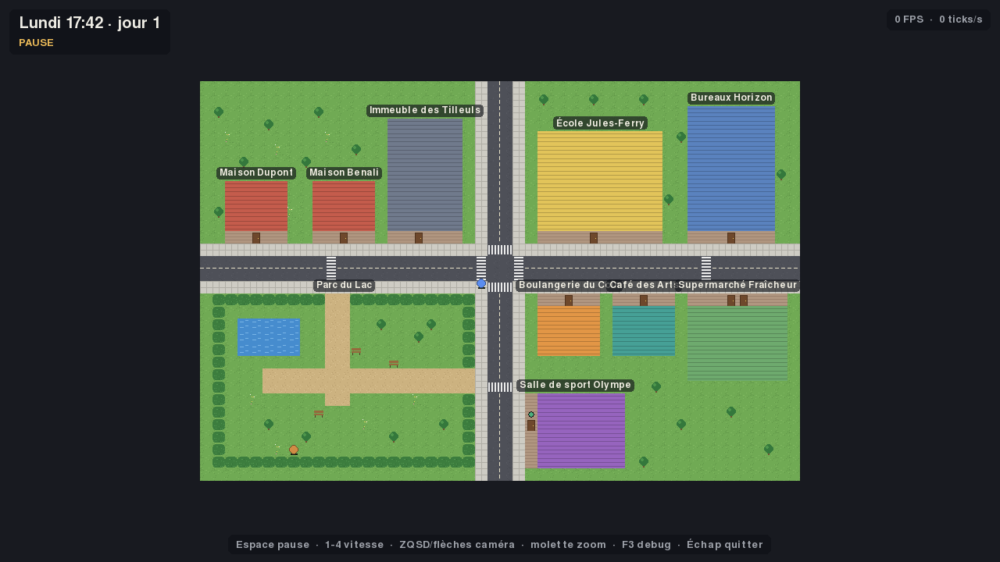
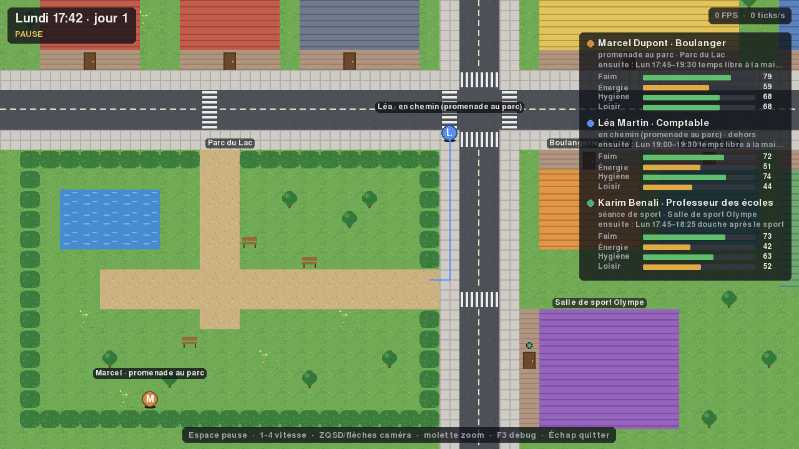

# PixelCity

Bac à sable de simulation de vie en pixel art : des habitants pilotés par des IA vivent, travaillent et interagissent dans une ville vue de dessus. À terme, on pourra y injecter un produit fictif et mesurer comment les habitants le découvrent, en parlent, l'achètent et le jugent.

Inspiré du papier *Generative Agents* (Stanford, 2023, la ville « Smallville ») et du projet open source *AI Town* : on reprend leur architecture, pas leur code.



## État du projet

| Étape | Contenu | État |
|---|---|---|
| 1 | MVP : carte de 10 lieux, 3 habitants, A*, horloge, routine sans LLM | **fait** |
| 2 | Ollama : planification de journée et conversations | à venir |
| 3 | Mémoire complète (flux, récupération, réflexion) | à venir |
| 4 | Ville complète, économie, transports | à venir |
| 5 | Interface d'observation complète | à venir |
| 6 | Module Test de produit et exports | à venir |
| 7 | Sauvegarde, optimisation, 50 à 100 habitants | à venir |
| 8 | Exécutable Windows (.exe) avec PyInstaller | à venir |

## Installation

Python **3.12** est requis. Sous Windows, travaille en natif (pas sous WSL) : PyInstaller ne sait pas fabriquer un `.exe` depuis Linux, et pygame sous WSL passe par une couche d'affichage moins fiable.

```powershell
# Windows (PowerShell)
py -3.12 -m venv .venv
.venv\Scripts\Activate.ps1
pip install -e ".[dev]"
```

```bash
# Linux / macOS
python3.12 -m venv .venv
source .venv/bin/activate
pip install -e ".[dev]"
```

`-e` installe le projet en mode « éditable » : tes modifications du code sont prises en compte sans réinstaller.

> Si PowerShell refuse d'exécuter `Activate.ps1` (« l'exécution de scripts est désactivée sur ce système »), autorise une fois les scripts locaux : `Set-ExecutionPolicy -Scope CurrentUser RemoteSigned`.

> N'installe jamais le paquet `pygame` à côté de `pygame-ce` : les deux fournissent le même module et s'écrasent mutuellement.

## Lancer

```bash
python -m pixelcity                                    # la ville, dans une fenêtre
python -m pixelcity --headless --days 7 --seed 42      # une semaine sans fenêtre, avec le journal
python -m pixelcity --headless --days 30 --quiet       # seulement le bilan
python -m pixelcity --headless --days 7 --log run.jsonl  # exporter les événements
```

Deux lancements avec la même graine produisent exactement la même simulation : le bilan affiche une « empreinte du journal » qui permet de le vérifier.

### Contrôles

| Touche | Action |
|---|---|
| Espace | pause / reprise |
| 1, 2, 3, 4 (rangée du haut ou pavé numérique) | vitesse x1, x2, x5, x10 |
| Z Q S D ou flèches | déplacer la caméra |
| Molette, Page haut / Page bas, + / − du pavé numérique | zoom (x1 à x4) |
| F3 | overlay de débogage : activité, chemin A* et besoins de chaque habitant |
| Échap | quitter |

Les touches de déplacement sont lues par **position physique** (scancodes) : ZQSD sur un clavier AZERTY, WASD sur un QWERTY, sans rien configurer.



## Tests et qualité

```bash
pytest          # une soixantaine de tests, quelques secondes
mypy            # typage strict
ruff check .    # lint
ruff format .   # formatage
```

Les tests couvrent notamment : l'optimalité d'A* (comparé à Dijkstra sur des grilles aléatoires), les horaires qui passent minuit, le déterminisme (même graine, même empreinte), les invariants d'une semaine complète (chacun dort chez soi à 3 h, est au travail pendant son service...) et la frontière d'architecture (le noyau tourne sans jamais importer pygame). Le rendu lui-même est testé avec une fenêtre factice.

## Modifier la ville

| Fichier | Contenu |
|---|---|
| `pixelcity/config/settings.yaml` | graine, temps, fenêtre, besoins et effets des activités |
| `pixelcity/config/city.yaml` | lieux : horaires, capacité, activités proposées |
| `pixelcity/config/agents.yaml` | habitants : identité, sommeil, travail, personnalité |
| `pixelcity/assets/maps/mvp.tmx` | la carte Tiled (géographie) |

Les fichiers YAML sont validés au démarrage avec des messages d'erreur précis. Les heures s'écrivent **entre guillemets** (`"07:30"`) : sans guillemets, YAML lit `23:00` comme un nombre.

La carte est générée par `python tools/make_mvp_map.py`. Tu peux l'ouvrir et la modifier dans [Tiled](https://www.mapeditor.org/) (attention : relancer le script écrase les retouches). Ce que la simulation attend de la carte :

- une couche de tuiles `ground` et une couche `structures` (encodage CSV ou base64 zlib/gzip) ;
- sur chaque tuile du tileset, les propriétés `walkable` (bool) et `cost` (int) ;
- un calque d'objets `places` : un rectangle par lieu, avec une propriété `place_id` égale à l'`id` du lieu dans `city.yaml` ;
- une entrée par lieu : une case marchable sur le bord du rectangle, ouverte vers l'extérieur (la porte).

`python tools/screenshot.py capture.png --hour 12.5 --debug` produit une capture du rendu sans ouvrir de fenêtre.

## Pour aller plus loin

- [ARCHITECTURE.md](ARCHITECTURE.md) : les choix d'architecture, leur raison d'être et les pièges rencontrés.
- [CREDITS.md](CREDITS.md) : licences des dépendances et des assets.
