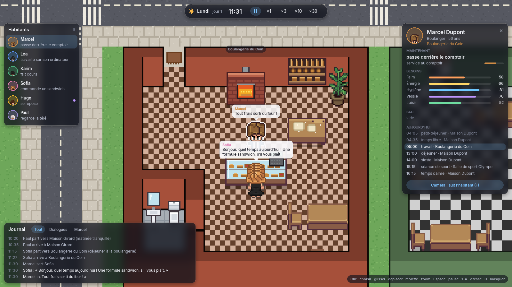
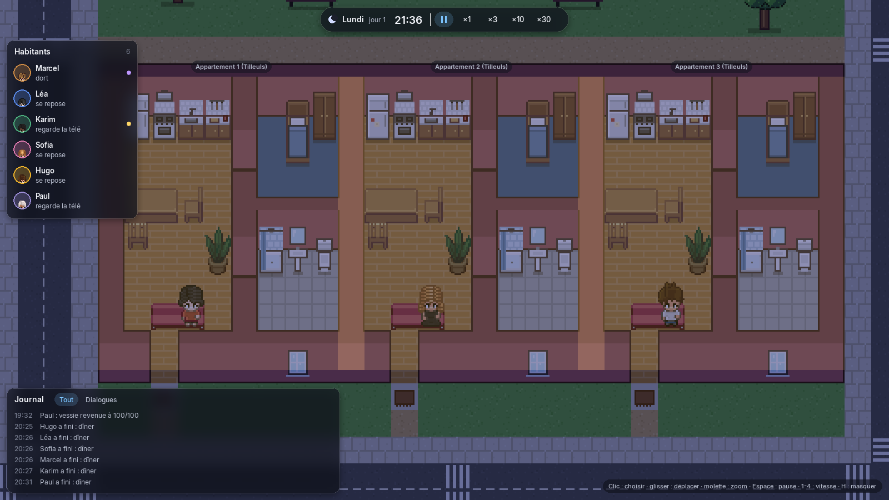

# PixelCity

Bac à sable de simulation de vie en pixel art : des habitants pilotés par des IA vivent, travaillent et interagissent dans une ville vue de dessus, dont on voit l'intérieur de chaque maison et de chaque commerce. À terme, on pourra y injecter un produit fictif et mesurer comment les habitants le découvrent, en parlent, l'achètent et le jugent.

Inspiré du papier *Generative Agents* (Stanford, 2023, la ville « Smallville ») et du projet open source *AI Town* : on reprend leur architecture, pas leur code. La direction artistique est celle de [pixel-agents](https://github.com/pixel-agents-hq/pixel-agents), dont on réutilise les assets (licence MIT).


## Ce que l'on voit

- **Une ville de 96 × 64 tuiles** : quatre maisons, une résidence de trois appartements, une boulangerie, un café, un supermarché, des bureaux, une école, une salle de sport et un parc. Pas de toits : on voit tout ce qui se passe à l'intérieur.
- **Des besoins comblés par des gestes visibles** : pour dîner, un habitant sort des ingrédients du frigo (s'il en reste), épluche les légumes, allume la cuisinière, s'assoit à table, puis fait la vaisselle. Douche le matin, toilettes, courses rangées dans le frigo en rentrant, gamelle préparée quand il n'y a rien d'ouvert à midi...
- **Des commerces qui vivent** : on fait la queue, le boulanger lâche son pétrin pour servir, client et vendeur échangent quelques répliques (bulles), la vitrine peut se vider. Sans caissière, la caisse du supermarché passe en libre-service.
- **Des relations** : chaque échange rapproche (ou non) deux habitants, selon leurs caractères.
- **Le jour et la nuit** : crépuscule orangé, nuit bleutée, fenêtres éclairées là où quelqu'un est réveillé, lampadaires.



## État du projet

| Étape | Contenu | État |
|---|---|---|
| 1 | MVP : carte, 3 habitants, A*, horloge, routine sans LLM | **fait** |
| 2 | Ville visible : assets pixel-agents, intérieurs, besoins par gestes concrets, commerces (file, service, stock), interface translucide | **fait** |
| 3 | Conversations par LLM local (Ollama) : en ville et au comptoir, affinités, flirt (entre adultes uniquement) | à venir |
| 4 | Studio : créer les habitants de chaque simulation (LLM, idéologie, façon de parler, apparence) | à venir |
| 5 | Mémoire complète (flux, récupération, réflexion) | à venir |
| 6 | Économie, plus de bâtiments, transports | à venir |
| 7 | Module Test de produit et exports | à venir |
| 8 | Sauvegarde, optimisation, 50 à 100 habitants | à venir |
| 9 | Exécutable Windows (.exe) avec PyInstaller | à venir |

## Installation

Python **3.12** est requis. Sous Windows, travaille en natif (pas sous WSL) : PyInstaller ne sait pas fabriquer un `.exe` depuis Linux, et pygame sous WSL passe par une couche d'affichage moins fiable.

`py --list` affiche les versions de Python installées. Si la 3.12 manque : `winget install -e --id Python.Python.3.12` (ou l'installateur Windows de la dernière 3.12 sur python.org).

```powershell
# Windows (PowerShell)
py -3.12 -m venv .venv
.venv\Scripts\Activate.ps1
python --version                    # doit afficher Python 3.12.x
python -m pip install -e ".[dev]"
```

```bash
# Linux / macOS
python3.12 -m venv .venv
source .venv/bin/activate
python --version
python -m pip install -e ".[dev]"
```

`-e` installe le projet en mode « éditable » : tes modifications du code sont prises en compte sans réinstaller.

> Vérifie toujours `python --version` après l'activation, et installe avec `python -m pip` plutôt que `pip` : un autre outil (un agent IA, Anaconda...) peut avoir placé son propre Python plus tôt dans le PATH. `python -m pip` installe pour l'interpréteur que tu viens de vérifier ; `pip` seul prend le premier `pip.exe` trouvé. `Get-Command python` (PowerShell) ou `which python` (Linux) montre lequel est utilisé.

> Si PowerShell refuse d'exécuter `Activate.ps1` (« l'exécution de scripts est désactivée sur ce système »), autorise une fois les scripts locaux : `Set-ExecutionPolicy -Scope CurrentUser RemoteSigned`.

> N'installe jamais le paquet `pygame` à côté de `pygame-ce` : les deux fournissent le même module et s'écrasent mutuellement.

## Lancer

```bash
python -m pixelcity                                    # la ville, dans une fenêtre
python -m pixelcity --headless --days 7 --seed 42      # une semaine sans fenêtre, avec le journal
python -m pixelcity --headless --days 30 --quiet       # seulement le bilan
python -m pixelcity --headless --days 7 --log run.jsonl  # exporter les événements
```

Deux lancements avec la même graine produisent exactement la même simulation : le bilan affiche une « empreinte du journal » qui permet de le vérifier.

### Contrôles

| Touche / souris | Action |
|---|---|
| Clic sur un habitant (ou sur son nom dans la liste) | le sélectionner : sa fiche s'ouvre et la caméra le suit |
| Clic sur un bâtiment | fiche du lieu : ouvert ou fermé, présents, stocks, comptoir |
| Glisser (clic gauche, droit ou molette) | déplacer la caméra |
| Molette, Page haut / Page bas | zoom (x1 à x6) |
| Z Q S D ou flèches | déplacer la caméra au clavier |
| Espace | pause / reprise |
| 1, 2, 3, 4 (rangée du haut ou pavé numérique) | vitesse x1, x3, x10, x30 |
| F | suivre ou non l'habitant sélectionné |
| Tab | habitant suivant |
| H | masquer l'interface |
| L | lumière jour/nuit (activer / couper) |
| F3 | couche de débogage : chemins A*, images/s, ticks/s |
| Échap | fermer la fiche ; si rien n'est ouvert, quitter |

À la vitesse x1, une minute simulée dure une seconde : on a le temps de lire les bulles et de voir chaque geste. Les touches sont lues par **position physique** (scancodes) : ZQSD sur un clavier AZERTY, WASD sur un QWERTY, sans rien configurer.



## Tests et qualité

```bash
pytest          # une centaine de tests, ~1 min
mypy            # typage strict
ruff check .    # lint
ruff format .   # formatage
```

Les tests couvrent notamment : le petit-déjeuner qui passe vraiment par le frigo, la cuisinière allumée pendant la cuisson, une envie pressante qui interrompt le travail puis le laisse reprendre, le service au comptoir (stock, rupture, caisse automatique), le planificateur (courses quand le frigo est vide, gamelle quand rien n'est ouvert), les invariants d'une semaine complète (personne ne se perd, aucune réservation fantôme, aucun objet allumé pour rien, des frigos jamais vides), le déterminisme (même graine, même empreinte) et la frontière d'architecture (le noyau tourne sans jamais importer pygame). Le rendu est testé avec une fenêtre factice.

## Modifier la ville

| Fichier | Contenu |
|---|---|
| `pixelcity/config/settings.yaml` | graine, temps, fenêtre, vitesse de marche, besoins |
| `pixelcity/config/city.yaml` | lieux : horaires, capacité, qui peut y faire quoi |
| `pixelcity/config/agents.yaml` | habitants : identité, apparence, sommeil, travail, personnalité |
| `pixelcity/config/objects.yaml` | ce que permet chaque meuble (verbes, places, stocks, ventes) |
| `pixelcity/config/actions.yaml` | les recettes : comment, geste par geste, on dîne, on fait ses courses, on travaille |
| `pixelcity/config/dialogues.yaml` | les répliques des commerces (en attendant les LLM de l'étape 3) |
| `tools/make_city.py` | le plan de la ville (gabarits de bâtiments), qui écrit `assets/maps/city.tmx` |

Les fichiers YAML sont validés au démarrage avec des messages d'erreur précis : une recette qui utilise un verbe qu'aucun meuble ne propose, ou un article inconnu, est signalée immédiatement. Les heures s'écrivent **entre guillemets** (`"07:30"`) : sans guillemets, YAML lit `23:00` comme un nombre.

Outils :

```bash
python tools/import_pixel_agents.py ../pixel-agents   # (re)copier les assets de pixel-agents
python tools/draw_assets.py --sheet planche.png       # redessiner nos meubles et sols (+ planche contact)
python tools/make_city.py                             # régénérer la carte
python tools/preview_city.py apercu/                  # aperçu de la carte entière, sans lancer le jeu
python tools/screenshot.py capture.png --day 1 --hour 11.5 --play 2 --zoom 4 --select marcel
```

La carte peut s'ouvrir et se retoucher dans [Tiled](https://www.mapeditor.org/) (attention : relancer `make_city.py` écrase les retouches). Ce que la simulation attend de la carte :

- deux couches de tuiles, `ground` (sols) et `walls` (murs), avec sur chaque tuile du tileset les propriétés `walkable`, `cost` et, pour les murs, `wall_style` ;
- trois calques d'objets : `places` (un rectangle par lieu, propriété `place_id` = l'`id` de `city.yaml`), `rooms` (les pièces) et `furniture` (un objet par meuble, propriétés `furniture`, `orientation`, `place_id`) ;
- au moins une porte par lieu : une case marchable de son bord, ouverte vers l'extérieur.

Au chargement, on vérifie que les meubles ne se chevauchent pas, que toutes les entrées sont reliées et que chaque place d'utilisation (devant le frigo, sur la chaise...) est atteignable.

## Pour aller plus loin

- [ARCHITECTURE.md](ARCHITECTURE.md) : les choix d'architecture, leur raison d'être et les pièges rencontrés.
- [CREDITS.md](CREDITS.md) : licences des dépendances, des assets et de la police.
